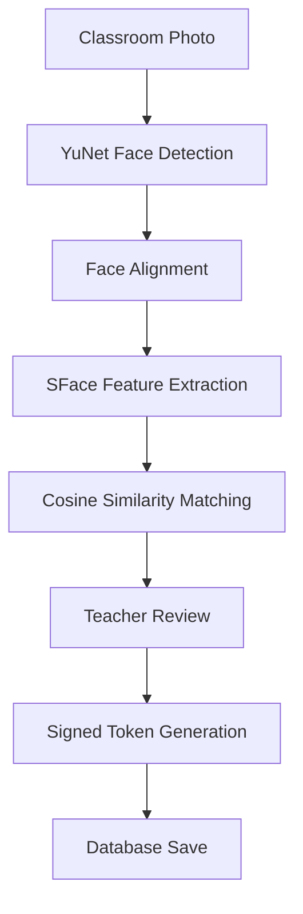

# Attendify

Attendify is a face-recognition based student attendance application. It enables teachers to track class attendance efficiently through QR codes or by analyzing classroom photos using facial recognition, all without permanently storing classroom photos or exposing sensitive biometric embeddings.

## Features
- Role-based authentication (Teacher/Student)
- Class and session management
- QR code-based check-in
- Classroom photo-based attendance using face recognition
- Detailed attendance history and analytics
- CSV and PDF report generation
- Secure profile management

## Technology Stack
- **Backend:** Python, Flask, SQLite
- **Frontend:** HTML, CSS (Flask templates)
- **Face Detection:** YuNet (ONNX)
- **Face Recognition:** SFace (ONNX)
- **Libraries:** OpenCV, Flask-WTF, qrcode, ReportLab

## Architecture


## Setup & Installation

### 1. Prerequisites
- Python 3.8+

### 2. Virtual Environment
```bash
python -m venv myvenv
myvenv\Scripts\activate  # Windows
# or
source myvenv/bin/activate  # Mac/Linux
```

### 3. Dependencies
```bash
pip install -r requirements.txt
```

### 4. Configuration
Copy `.env.example` to `.env` and fill in the details. Ensure `FLASK_SECRET_KEY` is securely generated.
```bash
cp .env.example .env
```
Key Environment Variables:
- `FLASK_SECRET_KEY`: Security key for sessions and CSRF.
- `DATABASE_PATH`: Path to SQLite database.
- `MODEL_DIRECTORY`: Directory containing ONNX models.

### 5. Database Initialization
```bash
python -c "from database.database import init_db; import os; init_db(os.environ.get('DATABASE_PATH', 'database/attendance.db'))"
```

### 6. Model Files
Download the required YuNet and SFace ONNX models directly into your `MODEL_DIRECTORY` (default: `models/`) by running:
```bash
python download_model.py
```
This script downloads both models. The application expects the files to be named exactly `face_detection_yunet_2023mar.onnx` and `face_recognition_sface_2021dec.onnx`. Note that an internet connection is required for this step.

## Running Locally (Development)
For local development, enable debug mode in `.env` (`FLASK_DEBUG=1`).
```bash
python app.py
```

## Running in Production
Refer to [DEPLOYMENT.md](DEPLOYMENT.md) for full deployment instructions. Production must use a proper WSGI server (e.g., Waitress or Gunicorn) and disable debug mode.

## Workflows

### Teacher Workflow
1. Register and log in.
2. Create a class.
3. Start an attendance session.
4. Display the QR code or upload a classroom photo.
5. Review recognized faces and confirm attendance.
6. Export CSV/PDF reports.

### Student Workflow
1. Register and log in.
2. Upload a clear profile picture to enroll your face embedding.
3. Join classes using class codes.
4. Check-in via QR code or be marked present via classroom photos.
5. View personal attendance history.

### Classroom Photo Attendance Workflow
1. Teacher uploads a photo.
2. Faces are detected by YuNet.
3. Features extracted by SFace and matched against enrolled students in the class.
4. Teacher reviews matches.
5. Application generates a signed, time-limited token representing the review.
6. Final submission securely records attendance.

## Security Features
- Debug mode is strictly disabled in production.
- Flask-WTF CSRF protection is globally applied.
- Passwords are hashed using Werkzeug.
- Signed save tokens prevent tampering and replay attacks.
- Classroom photos are NEVER permanently stored (only kept in memory or temporary annotated files for review).
- Face embeddings are never exposed through API endpoints.
- Uploads are validated strictly (MIME types, Pillow verification, size limits).

## Testing
Run the complete regression suite:
```bash
python -m unittest discover -p "test_*.py" -v
```

## Known Limitations
- Does not currently support live webcam streaming.
- SFace calibration dataset was small; the recognition threshold is strictly maintained at 0.363 until further validation.
- Requires HTTPS (reverse proxy) for secure session cookie usage in production.
